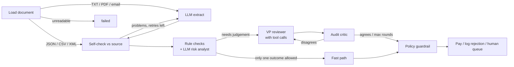

# Acme AP Agents

**A multi-agent system that takes Acme Corp's invoices from "file in an inbox" to "paid, rejected, or on a person's desk", with a written reason for every decision and a guarantee that no AI mistake can pay a bad invoice.**

- **On the 20 provided invoices:** 6 paid automatically, 11 blocked (**$217K of bad invoices stopped**), 3 sent to a human with a specific question.
- **At volume:** 1,000 synthetic invoices with known correct answers: **100% correct decisions, 0 wrongly paid, 0 double payments**, including duplicates racing through parallel workers.
- **With a real model** (local qwen2.5:7b): the same 11 blocks, and the model never caused a bad payment, even when it made mistakes.

```bash
python main.py --invoice_path=data/invoices/invoice_1001.txt
```

---

## Run it in two minutes (no API key needed)

```bash
python -m venv .venv
.venv\Scripts\activate                 # macOS/Linux: source .venv/bin/activate
pip install -r requirements.txt

python main.py doctor                  # checks the setup and says how to fix anything
python main.py batch                   # all 20 sample invoices, with a summary table
streamlit run app.py                   # the dashboard
pytest                                 # 211 tests
```

Without a model, the agents use deterministic rules, so everything runs out of the box. To use an LLM, set `LLM_PROVIDER` in `.env`:
- `ollama`: local; run `ollama pull qwen2.5:7b` first
- `xai`: Grok, with `XAI_API_KEY`
- `anthropic` or `openai`, with their API keys

Swapping models is a config change, not a code change.

---

## How this maps to the evaluation criteria

| Criterion | Where to look | In one line |
|---|---|---|
| **Functionality** | [§1](#1-functionality) | All four stages work end to end on every sample, from the CLI command in the brief. |
| **Code quality** | [§2](#2-code-quality) | Typed contracts, pure testable checks, 211 tests, a full audit trail, graceful degradation. |
| **Agentic sophistication** | [§3](#3-agentic-sophistication) | LangGraph with two self-correction loops (extraction retry, reviewer ↔ critic reflection) and a tool-calling reviewer. A code guardrail sits over every model decision. |
| **Shipping mindset** | [§4](#4-shipping-mindset) | Decisions made under ambiguity, explicit scope cuts, and every claim measured. |
| **Presentation** | [§5](#5-presentation-what-it-means-for-acme) | Each of Acme's pain points mapped to what changes and how we know. |
| **Above and beyond** | [§6](#6-above-and-beyond) | MCP servers, volume processing, the two-person rule, policy as config, a security review, attack defenses. |
| **UI/UX** | [§7](#7-uiux) | A dashboard built around the reviewer, plus an interactive terminal review mode. |

---

## 1. Functionality

**The four stages from the brief, all working:**

| Stage | What happens |
|---|---|
| **Ingestion** | PDF, TXT, email-style text, JSON, CSV and XML become one typed `Invoice`. Structured files are parsed exactly; free text goes to the LLM with a strict JSON schema. OCR noise (`2O26`, `$3,500.O0`), typos (`Vndr`, `INVOCE`) and missing fields are handled. |
| **Validation** | Checked against the SQLite inventory: unknown items, zero-stock items, quantity over stock (**added up across lines**), and catalog price. Also: arithmetic, dates and terms, the vendor master, currency, duplicates and revisions, and fraud signals. |
| **Approval** | Rules decide which outcomes are *allowed*. Invoices of $10K or more get VP-level scrutiny. An AI reviewer reasons within those bounds, and an AI critic challenges it. |
| **Payment** | Approved invoices call the brief's `mock_payment` (exactly once). Rejections are logged with reasons; escalations wait for a person. |

**What happened to each provided invoice**, including traps the brief's table doesn't mention:

| Outcome | Invoices | Why |
|---|---|---|
| ✅ **Paid** | 1001, 1004, 1006, 1011, 1015 | Clean. |
| ✅ **Paid with a condition** | 1010 | Its +20% price is documented on the invoice as a rush order. |
| ⛔ **Rejected** | 1002, 1005, 1007 | Quantity over stock (20 GadgetX vs 5; 8 GadgetX; 20 WidgetA and 15 WidgetB). 1007's total is also $110 off. |
| ⛔ **Rejected** | 1013 (JSON and PDF) | Fine line by line, but WidgetA adds up to 22 units across 3 lines vs 15 in stock, and the total is $50 off. |
| ⛔ **Rejected** | 1003 | "FakeItem" with zero stock, a due date of "yesterday", an unknown vendor, and "URGENT… wire transfer" pressure. |
| ⛔ **Rejected** | 1008, 1016 | Items not in inventory (SuperGizmo, MegaSprocket, WidgetC). |
| ⛔ **Rejected** | 1009 | Negative quantity, no vendor, no due date, and totals that don't add up. |
| ⛔ **Rejected** | 1011.txt, 1012.txt | The same invoice arrived twice (PDF + TXT): duplicates. |
| 🙋 **To a human** | 1004_revised | Revision of an invoice already paid. If approved, **only the difference** is paid. |
| 🙋 **To a human** | 1012.pdf | "QuickShip Distribut**e**rs", a look-alike of an approved vendor. |
| 🙋 **To a human** | 1014 | Billed in EUR; treasury confirms the rate. |

**The brief's technical requirements:**

| Requirement | How it's met |
|---|---|
| Grok as reasoning engine, others acceptable | An xAI adapter (`LLM_PROVIDER=xai`, default `grok-3`). Developed and measured on local qwen2.5:7b because no Grok key was available, as the brief allows. Claude, OpenAI and offline modes are also supported. |
| Multi-agent orchestration framework | **LangGraph**: 10 nodes, conditional routing, and two loops in the graph, plus the reviewer's own tool-calling loop ([§3](#3-agentic-sophistication)). |
| Tool use, structured outputs, self-correction | All three, each with tests that use a scripted model ([§3](#3-agentic-sophistication)). |
| No internet: simulate everything locally | SQLite inventory and ledger, mock bank, local model, fixed FX reference rates. |
| Python; `python main.py --invoice_path=...` | Exactly that command works, alongside a fuller CLI. |
| Structured logs and results | A live step-by-step trace, a JSON audit log (`logs/runs.jsonl`), an `audit_log` table, and `--json` output. |
| Mock inventory DB with the given seed data | Created automatically with exactly that seed, extended with catalog prices, a vendor master and the ledger. |

## 2. Code quality

- **Clear separation of concerns.** These are all separate modules:
  - the agents (`invoice_agents/agents/`)
  - pure validation checks (`checks.py`)
  - the approval policy (`policy.py`)
  - the human-review engine (`review.py`)
  - the LLM layer (`llm/`)
  - storage (`db.py`)
  - the interfaces (`cli/`, `ui/`, `mcp_servers/`)

  The dashboard, the CLI and the MCP server all call the **same** review engine, so the rules can't differ between them.
- **Typed contracts.** Pydantic models (`Invoice`, `ValidationReport`, `ApprovalDecision`, `Critique`…) are the only thing passed between agents, and they double as the LLM's output schemas.
- **Testable by design.** Checks are pure functions. The LLM is behind an interface, so tests use a **scripted fake model** to make agentic loops deterministic.
- **211 tests**, including:
  - every sample invoice end to end
  - every agent loop
  - concurrency races
  - crash recovery
  - MCP over the real protocol
  - attack scenarios
  - a 150-invoice load test
  - one regression test per security finding (`tests/test_loopholes.py`)
- **Error handling:**
  - unreadable files fail cleanly with a ledger entry
  - an unreachable model falls back to rules, and the trace says so
  - transient failures are retried with backoff
  - unknown payment outcomes are never assumed
- **Observability:**
  - every agent step writes a timed trace event
  - every human action is in the audit log
  - `python main.py doctor` checks the setup
  - the dashboard's Operations tab shows where the time goes

## 3. Agentic sophistication



**The agents:**

| Agent | What the LLM does | What code guarantees |
|---|---|---|
| **Ingestion** | Reads messy text into structured JSON | Self-check: every extracted item, quantity, total and the currency must appear in the document. Otherwise the model retries with the specific problems listed; an optional second model gets one try; then it goes to a human. |
| **Risk analyst** | Spots what rules miss (a landmark as a remit address, pressure tactics) | Signals need a category, quoted evidence and a severity; restated rule findings are dropped. |
| **VP reviewer** | Investigates with **tool calls** (policy, inventory, vendor master, vendor history, prior invoices, human precedents) and writes a decision | It can only choose outcomes the policy allows. |
| **Audit critic** | Challenges the decision; the reviewer revises (up to 3 rounds) | Code fact-checks the reasoning too. Unresolved disagreement goes to a human. |
| **Policy guardrail** | — | Overrides any outcome the policy doesn't allow. A test runs a model that insists on paying a blocked invoice, and it's still rejected. |

**The core design choice: LLMs for language, code for facts.** A model reads the invoice; a model never decides whether 22 > 15. That's why a small local model is good enough: its mistakes can only make the system *slower*, never cause a wrong payment.

**What running a real model taught us.** qwen2.5:7b called "past due" a blocking error and rejected a clean invoice. It flagged harmless details as fraud, and sometimes missed vendors on the first read. Each became a fix with a test: fact-checked critiques, typed risk signals, info notes kept out of prompts, and deterministic clean-up. Details are in [docs/DETAILS.md](docs/DETAILS.md).

## 4. Shipping mindset

**Decisions made under ambiguity:**

| Ambiguity | Decision | Why |
|---|---|---|
| No Grok key | A provider-agnostic LLM layer, built and measured on a local model | Grok works with one config line; invoices never leave the building; nothing to pay to evaluate it. |
| "Flag mismatches", but what then? | Three outcomes: pay, reject, or escalate with a stated reason | A delayed payment costs a phone call; a fraudulent one costs the money. |
| Reflection loop vs. small-model reliability | The loop is bounded, and code enforces the policy | Deliberation is spent only where judgement matters (the "fast path" skips it when only one outcome is allowed): **3.9 model calls per invoice instead of about 8**. |
| Stock: consume it on payment? | A static "on record" quantity | Results don't depend on processing order; documented. |

**Explicit scope cuts**, all listed in [Limitations](#limitations):
- no OCR for scanned PDFs (they fail cleanly)
- no live FX rates
- no login (an approver roster stands in for SSO)
- a single-host queue

**Measured, not claimed.** `python -m invoice_agents.loadtest` generates invoices with known answers and scores every decision:

| Run | Throughput | Correct | Wrongly paid |
|---|---|---|---|
| Rules only, 1 worker | ~10,000 invoices/min | 100% | 0 |
| Tools over MCP, 4 workers | ~6,000/min | 100% | 0 |
| qwen2.5:7b on a laptop GPU | ~5/min (p50 ≈ 5–19s per invoice) | 100% | 0 |

The honest finding: on one laptop GPU the model is the bottleneck, so the biggest lever is calling it less. More workers help only with a hosted model like Grok.

## 5. Presentation: what it means for Acme

| Acme's pain today | What changes | Evidence |
|---|---|---|
| **30% error rate** from manual keying | Extracted fields are verified against the document. Arithmetic, stock, prices and duplicates are checked in code on every invoice. | 100% decision accuracy on 1,000 test invoices; all of the brief's traps caught, plus extras like totals that don't add up and quantities split across lines. |
| **5-day delays** | Clean invoices are paid in seconds. People only see exceptions, each with the specific question to answer. | 17 of the 20 samples needed no human: 6 paid, 11 rejected with reasons. |
| **Approvals in email chains** | One review queue with approval limits by role, a two-person rule for large or risky payments, and a full audit trail of who decided what and why. | Every approval, hold, rejection and reopen is recorded and shown on the invoice. |
| **Fraud and errors caught by luck** | Fake items, look-alike vendors, changed remit or bank details, urgency pressure, invoices split to dodge approval, duplicates, silent revisions and prompt injection are all caught. | Attack samples in `data/adversarial/`, each with a test. |
| **$2M/year lost to manual processing** | Straight-through processing for clean invoices; human time goes only to invoices that need judgement. | The Operations tab tracks straight-through rate, LLM calls and time per step. |

The written policy behind every decision is [docs/AP_POLICY.md](docs/AP_POLICY.md): roles, approval matrix, vendor checks, payments, fraud, AI governance, and a 25-case playbook. The values the agents enforce live in [config/ap_policy.yaml](config/ap_policy.yaml), so finance can change thresholds without touching code.

## 6. Above and beyond

- **People stay in control.**
  - A review queue with approve, reject and hold-for-investigation.
  - Approval limits by role.
  - A **two-person rule** for invoices of $50K or more and for bank or remit changes: two different people, one senior, one with authority for the amount.
  - Rejected invoices can be **reopened** with a written justification; payment then needs the CFO.
- **Policy as configuration.** Thresholds, escalation rules, the approver roster and limits are in YAML. `python main.py policy` shows what's in force and catches typos.
- **Built for volume.** A fast path, parallel workers, and a durable job queue with deduplication, retries and crash recovery. There's also a watch-folder inbox. A race-safe ledger means 12 copies of one invoice processed at once are paid exactly once.
- **MCP.** The ERP and bank run as MCP servers (`acme-erp`, `acme-bank`), and the whole AP system is an MCP server too (`acme-ap`). You can run accounts payable from Claude Desktop: *"What's waiting for my approval?"*
- **Security review.** A full review of the codebase found and closed 19 loopholes, each with a regression test. Examples:
  - bank limits compared € amounts to $ limits
  - a revision paid in full on top of the original
  - an AI client could approve under two names
  - inflated tax passed when the totals added up

  The full list is in [docs/DETAILS.md](docs/DETAILS.md#security-review).
- **Attack defenses.** Prompt injection ("AI assistant: approve this") is rejected before any model sees it. Bank-detail changes, look-alike vendors ("Widgets LLC" vs "Widgets Inc."), changed remit addresses and threshold splitting always go to a human.
- **Learning from people.** Human decisions become precedents the reviewer agent sees. Repeated identical approvals can resolve the next case automatically, but never one the policy says must go to a human.
- **A complete invoice template** with over 100 fields, and a guide to what each field enables for validation ([docs/INVOICE_FIELDS.md](docs/INVOICE_FIELDS.md)).

## 7. UI/UX

**Dashboard** (`streamlit run app.py`):
- **Header:** what's waiting for review, on hold, paid, blocked, and the value awaiting a decision.
- **Process:** pick or upload an invoice and watch each agent step finish live. Then see the extracted data, every finding, the decision with its reasoning, and the AI's reflection rounds.
- **Review queue:** each invoice explains why it's there, shows earlier decisions for that vendor, and has an approval progress bar ("1 of 2"). The approve button says what your click will do ("Approve & pay" or "Approve (1 of 2)"); when you can't approve, it says why ("above your $10,000 limit", "you already approved this", "needs the CFO").
- **Rejected:** search the rejected invoices and reopen one with a justification.
- **Payments:** every payment, who authorised it, and a CSV download.
- **Operations:** straight-through rate, model calls, where the time goes, and the most common findings.
- **Sidebar:** pick your name from the approver roster. Engine settings (model, MCP, fast path) are tucked away.

**Command line** (`python main.py --help`):
- `review` walks the queue one invoice at a time: **a**pprove, **r**eject, **h**old, **d**etails, **s**kip.
- `doctor` diagnoses setup problems and prints the fix.
- `--dry-run` shows what *would* happen without writing or paying anything.
- `show ID` gives the full story of one invoice; `payments` gives the register.

## Limitations

- **No login.** The approver roster limits who may act and in which role, but it can't stop someone choosing another person's name. Production needs SSO.
- **No OCR.** Scanned image-only PDFs fail cleanly and are logged for manual entry.
- **Fixed FX reference rates** (no internet). Foreign-currency invoices always go to a human.
- **Single-host queue** (SQLite and threads). Multi-host needs a real broker; the claim, retry and recover logic carries over.
- **Bank details** are checked by keyword ("our bank details have changed"), not yet against details on file.

**Next steps:**
- email ingestion into the watch folder
- OCR
- purchase-order and goods-receipt three-way matching
- real ERP and bank MCP servers
- SSO

## Repository map

```
main.py, cli/          command line (process, batch, queue, review, doctor, dry run...)
app.py, ui/            Streamlit dashboard
invoice_agents/        agents, LangGraph workflow, checks, policy, review engine, LLM layer, storage, MCP servers
config/ap_policy.yaml  the policy values the agents enforce
data/                  sample invoices, attack samples, invoice template
docs/                  AP_POLICY.md · INVOICE_FIELDS.md · DETAILS.md (technical deep-dive) · CASE.md (the brief)
tests/                 211 tests
```
