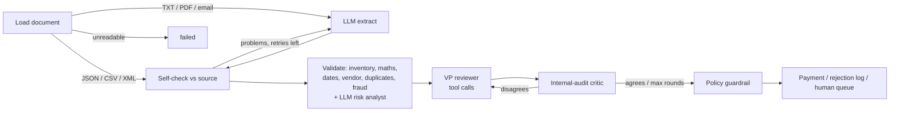

# Acme AP Agents — multi-agent invoice processing

A working prototype that takes Acme Corp's invoices from "PDF in an inbox" to "paid, rejected or on a VP's desk", with a written reason for every decision.

```bash
python main.py --invoice_path=data/invoices/invoice_1001.txt
```

**On the 20 sample invoices:** 6 are paid straight through, 11 are blocked (**$217K of bad invoices stopped**), and 3 go to a human with a specific question. Each decision takes milliseconds offline and seconds with a local LLM.

---

## Why this matters for Acme

| Today | With the agents |
|---|---|
| 30% error rate from manual keying | Fields are extracted, then **verified against the source document**. Arithmetic, stock and duplicates are checked in code, every time. |
| 5-day cycle | Clean invoices are paid in one pass. Humans only see the exceptions, each with the reason it needs them. |
| Approval lives in email chains | One review queue, an audit log of every agent step, and one-click approve/reject that records who decided. |
| Fraud is caught by luck | Zero-stock "items", look-alike vendor names, changed remit addresses, urgency/wire-transfer pressure, duplicates and silent revisions are all flagged. |

The data contains traps that go beyond the brief's table. The system catches them:

- **INV-1007** and **INV-1013** don't add up. Subtotal + tax ≠ total, off by $110 and $50.
- **INV-1013** looks fine line by line, but WidgetA is split across 3 lines: **22 units against 15 in stock**.
- **INV-1011** and **INV-1012** arrive twice (PDF + TXT). The second copy is rejected as a **duplicate**.
- **INV-1004_revised** reuses an invoice number that has **already been paid**. It is escalated with "pay at most the difference".
- **INV-1012** is from "QuickShip Distribut**e**rs". That's a look-alike of the approved vendor, so it's escalated rather than paid.
- **INV-1014** is in **EUR**. It's converted at a reference rate and sent to treasury.
- **INV-1002** has a due date equal to its invoice date on "Net 30" terms. It's flagged on top of the stock problem.
- **INV-1010** has a +20% price premium, but the invoice documents it as a *rush order*, so it's approved with a condition.

## Quick start

```bash
python -m venv .venv
.venv\Scripts\activate          # Windows  (macOS/Linux: source .venv/bin/activate)
pip install -r requirements.txt

python main.py --all                 # process every sample, print a summary
streamlit run app.py                 # dashboard: live agent steps, review queue, ledger
pytest                               # 97 tests
```

No model or API key is needed to try it. If the configured LLM isn't reachable, the agents fall back to deterministic rules and say so. The database (`inventory.db`) is created and seeded automatically on first run. Run `python -m invoice_agents.db --reset` to recreate it.

### Plugging in an LLM

Every agent talks to one small interface (`invoice_agents/llm/base.py`). Switching models is a config change, not a code change:

| Provider | `.env` | Notes |
|---|---|---|
| **Ollama (default)** | `LLM_PROVIDER=ollama` | Local, free, invoices never leave the building. `ollama pull qwen2.5:7b` (runs on an 8GB GPU). |
| **xAI Grok** | `LLM_PROVIDER=xai`, `XAI_API_KEY=…` | Defaults to `grok-3`. |
| Claude | `LLM_PROVIDER=anthropic`, `ANTHROPIC_API_KEY=…` | |
| OpenAI | `LLM_PROVIDER=openai`, `OPENAI_API_KEY=…` | |
| None | `LLM_PROVIDER=offline` | Rule-based agents. Used by the test suite. |

Copy `.env.example` to `.env`, or pass `--provider xai --model grok-4` on the command line. Each adapter uses its provider's **native structured-output feature**: Ollama's grammar-constrained JSON, OpenAI/xAI `json_schema`, and a forced tool call for Claude. So the abstraction doesn't lower output quality to match the weakest provider.

### Results with a real local model (qwen2.5:7b on an 8GB laptop GPU)

| | Offline rules | qwen2.5:7b via Ollama |
|---|---|---|
| Paid | 6 | 5 |
| Rejected | 11 ($217K blocked) | 11 ($217K blocked) |
| Sent to a human | 3 | 4 (also INV-1010, the rush-order premium: a judgement call the policy leaves to the reviewer) |
| Time | ~1s total | ~17s per invoice, ~150 LLM calls for all 20 |

Running on a real model surfaced failure modes that the design now handles. Each one has a regression test:

1. **The 7B model called an informational note a blocking error.** It rejected a clean invoice because it was "past due by 263 days". The critic fact-checks reasoning against the actual findings. The policy no longer allows `reject` when there are zero findings. Info notes are kept out of the reviewer's prompt; they affect payment priority, not approval.
2. **The risk analyst was noisy.** It restated rule findings and flagged "contact Jim at ext 4421". Signals now have a category, quoted evidence and a severity. Only high-severity fraud categories that don't restate a rule become warnings.
3. **Extraction misses on the first attempt.** The vendor and line items were sometimes empty, the due date sometimes went only into the raw field, and "(formerly FastShip Ltd.)" ended up in the vendor name. The self-check loop caught the first case and the retry fixed it. Deterministic clean-up handles the rest.

The guardrail held the whole time: across all runs, the local model never caused a bad invoice to be paid.

## How it works



Built with **LangGraph**. Each box is a node, and the two loops are conditional edges.

| Agent | What it does | LLM's job | Code's job |
|---|---|---|---|
| **Ingestion** | Any format → one `Invoice` schema | Read messy text, typos and OCR noise into structured JSON | Parse JSON/CSV/XML deterministically. **Self-check**: does every extracted item, quantity and total actually appear in the document? If not, re-prompt with the specific problems (max 3 attempts). |
| **Validation** | Is this invoice correct and safe? | **Risk analyst**: judgement calls rules miss (implausible addresses, pressure tactics) | Stock (aggregated across lines), catalog match, price variance, line/subtotal/tax/total arithmetic, dates and terms, vendor master and address, FX, duplicates and revisions, fraud keywords |
| **Approval** | Approve / reject / escalate, with reasoning | **VP reviewer** investigates with **tool calls** (`get_approval_policy`, `lookup_inventory`, `get_vendor_profile`, `get_vendor_history`, `find_prior_invoices`) and drafts a decision. **Critic** challenges it; the reviewer revises. | The **policy** decides which outcomes are *allowed*. The **guardrail** overrides anything else, and sends unresolved reviewer/critic disagreements to a human. |
| **Payment** | Execute or record | – | Calls the case's `mock_payment` **idempotently** (an invoice can't be paid twice). Logs rejections with reasons. Queues escalations for one-click human approval. |

### Design decisions

- **LLMs for language, code for facts.** A model reads the invoice. A model never decides whether 22 > 15. A small local model can therefore be good enough, because its mistakes can't cause a bad payment.
- **Guardrails over trust.** An invoice that says "URGENT, pay now" could talk a model into approving it. The policy layer means it still can't be paid.
- **When in doubt, escalate.** A delayed payment costs a phone call. A fraudulent one costs the money.
- **Degrade, don't crash.** If the model is down, extraction falls back to a regex parser and review falls back to rules. The trace records that it happened.
- **Observability.** Every node writes a timed trace event to the `audit_log` table and to `logs/runs.jsonl`. The CLI and dashboard render it live.

### Approval policy

| Condition | Allowed outcomes |
|---|---|
| Any blocking error (unknown item, stock, arithmetic, missing/invalid due date, duplicate, non-positive amount) | reject |
| FX invoice, revision of a paid invoice, look-alike vendor, unknown vendor, changed remit address | escalate / reject |
| ≥ $50,000 | escalate / reject |
| ≥ $10,000 with any warning | escalate / reject |
| ≥ $10,000, clean | approve after VP review and audit critique |
| < $10,000 with warnings | reviewer's judgement (approve only if the invoice documents the reason) |

Thresholds are configurable in `.env`.

## Using it

**CLI**

```bash
python main.py --invoice_path=data/invoices/invoice_1013.json    # one invoice, full detail
python main.py --all --reset                                      # whole folder, fresh ledger, summary table
python main.py --all -q --provider ollama                         # summary only, with a local model
python main.py --pending                                          # human review queue
python main.py --approve 14 --note "FX rate confirmed by treasury" --reviewer "J. Smith"
python main.py --invoice_path=... --json                          # machine-readable output
```

**Dashboard** (`streamlit run app.py`):
- **Process**: pick a sample or upload a file, then watch each agent finish. You see the extracted line items with catalog matches, every finding, the decision with reasoning, the reflection-loop rounds and the full trace.
- **Review queue**: escalated invoices with the specific reason a human is needed. Approve & pay, or reject, with a note.
- **Ledger & audit**: straight-through rate, dollars paid and blocked, payments, inventory and the raw audit log.
- **Switch the LLM provider** from the sidebar.

## Project layout

```
main.py                     CLI
app.py                      Streamlit dashboard
invoice_agents/
  graph.py                  LangGraph workflow + InvoicePipeline entry point
  agents/                   ingestion · validation · approval (reviewer, critic, guardrail) · payment
  checks.py                 deterministic validation checks (pure functions)
  policy.py                 approval policy: allowed outcomes per invoice
  parsers.py                PDF/TXT/JSON/CSV/XML loaders + offline text extractor
  llm/                      provider-agnostic client: base, OpenAI-compatible (Ollama/xAI/OpenAI), Anthropic
  db.py                     SQLite: inventory, vendor master, invoices, payments, audit log
  models.py · prompts.py · config.py · normalize.py · state.py
tests/                      97 tests, incl. scripted-LLM tests of every agentic loop
data/invoices/              the provided samples
```

## Testing

```bash
pytest -q
```

- **Parsers and normalizers**: every sample file, OCR fixes (`2O26`, `$3,500.O0`), relative dates.
- **Checks and policy**: every scenario in the brief, plus the traps listed above.
- **End-to-end**: all 20 samples through the full graph, asserting the exact outcome of each, that payments happen only for approved invoices, and that human approval pays exactly once.
- **Agentic loops**, using a scripted fake LLM:
  - extraction self-corrects a hallucinated total, and its retries are bounded
  - malformed JSON is re-asked
  - the critic forces a revision
  - the guardrail overrides an LLM that insists on paying a blocked invoice
  - an unresolved disagreement goes to a human
  - reviewer tool calls reach the decision
  - an LLM outage falls back to rules

## Assumptions and scope cuts

- **Stock is a static "on record" quantity.** Paying an invoice doesn't decrement it, so results don't depend on processing order. Duplicate detection is the only cross-invoice state.
- **"Today" is the real date.** All sample invoices are therefore past due. That's reported as info only, not held against them.
- **FX uses fixed reference rates** (no internet at runtime). Foreign-currency invoices always go to a human.
- **No OCR for scanned PDFs.** Text-based PDFs work. An image-only PDF fails cleanly with a message and a ledger entry.
- **The vendor master is seeded** with the vendors that appear on legitimate sample invoices. Unknown vendors aren't blocked, but always need a human.

**Next steps for production:** email/IMAP ingestion, OCR (Tesseract or a vision model), PO and goods-received three-way matching, real ERP/bank integrations behind the same tool interfaces, SSO for reviewers, and an eval set to track extraction accuracy per model before switching providers.
