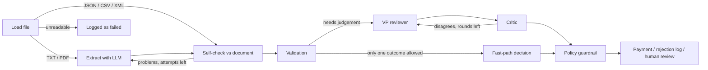

# Galatiq Case: Invoice Processing Automation

A working multi-agent prototype that automates Acme Corp's invoice processing end to end: ingestion, validation, approval and payment.

```bash
python main.py --invoice_path=data/invoices/invoice_1001.txt
```

## Background

Acme Corp loses about $2M a year on manual invoice processing: a 30% error rate, 5-day delays, and approvals spread across email chains. This system replaces the manual steps with agents. Every invoice is extracted, checked against the inventory database, approved or rejected under a written policy, and paid through the mock banking API. Each decision comes with a written reason.

**Results on the 20 provided invoices** (offline rules; with a local model, INV-1010 goes to a human instead of being paid):
- 6 paid automatically
- 11 rejected, which blocks $217K of incorrect or fraudulent invoices
- 3 sent to a human with a specific question

## Setup

```bash
python -m venv .venv
.venv\Scripts\activate          # macOS/Linux: source .venv/bin/activate
pip install -r requirements.txt
```

No API key is needed to try it. Without a model, the agents fall back to rule-based logic. To use an LLM, copy `.env.example` to `.env` and set `LLM_PROVIDER` (see [LLM integration](#llm-integration)).

Check that everything is set up:

```bash
python main.py doctor
```

## Running the system

The command from the brief:

```bash
python main.py --invoice_path=data/invoices/invoice_1001.txt
```

It prints a structured log of every agent step, the extracted invoice, the validation findings, and the final decision with its reasoning.

The main commands:

```bash
python main.py batch                              # process every invoice in data/invoices, with a summary table
python main.py review --as "Dana Lee"             # review escalated invoices one by one: approve, reject or hold
python main.py pending                            # list invoices waiting for a person
python main.py show INV-1006                      # everything about one invoice
python main.py approve INV-1014 --as "Dana Lee" --note "FX rate confirmed"
python main.py payments                           # every payment and who authorised it
python main.py reset                              # clear the ledger and start over
python main.py batch --dry-run                    # what would happen, without writing or paying anything
python main.py doctor                             # check the setup
streamlit run app.py                              # the dashboard
pytest                                            # the tests
```

Reviewers are the people on the approver roster in `config/ap_policy.yaml` (Dana Lee, Raj Mehta, Sam Patel, Ann Kim, Bo Chen); each person's role and approval limit comes from the roster. **These names are placeholders** (see [Placeholders](#placeholders)).

**Every command and option, the `.env` settings, and the other tools are in [docs/CLI.md](docs/CLI.md).**

## Workflow

The four stages are separate agents connected in a LangGraph workflow.



### 1. Ingestion

Extracts vendor, amount, line items with quantities, due date and other fields from PDF, TXT, JSON, CSV and XML files.

- **Structured files** (JSON, CSV, XML) are parsed directly, with no LLM needed.
- **Unstructured text and PDFs** go to the LLM, which returns JSON matching a strict schema.
- **A self-check** compares the LLM's extraction with the original document. Every item, quantity, the total and the currency must actually appear in it, and the vendor must not be Acme itself.
  - If something doesn't match, the LLM tries again with the specific problems listed, for up to 3 attempts in total.
  - An optional second model can then get one more try.
  - If the extraction still can't be verified, the invoice goes to a human instead of being paid or rejected.
- **Messy input** is handled: typos (`Vndr`, `INVOCE`), OCR errors (`2O26`, `$3,500.O0`), spacing variations (`Widget A`), missing fields, and dates like "yesterday".
- **Unreadable files** (for example a scanned PDF with no text) are logged as failed, so nothing silently disappears.

### 2. Validation

Checks each invoice against the SQLite database and a set of rules. The examples are from the provided invoices, except where noted.

| Check | Example |
|---|---|
| Quantity exceeds stock | INV-1002: 20× GadgetX, only 5 in stock |
| Quantities split across lines | INV-1013: WidgetA appears on 3 lines totalling 22, only 15 in stock |
| Zero-stock or fake item | INV-1003: FakeItem |
| Item not in inventory | INV-1008: SuperGizmo, MegaSprocket; INV-1016: WidgetC |
| Invalid data | INV-1009: negative quantity, missing vendor, missing due date |
| Arithmetic | INV-1007 and INV-1013: subtotal + tax doesn't equal the total |
| Price vs catalog | INV-1010: +20% on one line (documented as a rush order) |
| Duplicates and revisions | INV-1011 and INV-1012 arrive twice; INV-1004 is revised after being paid |
| Vendor checks | INV-1012: "QuickShip Distribut**e**rs" closely resembles an approved vendor |
| Currency | INV-1014: billed in EUR |
| Fraud signals | INV-1003: "URGENT… wire transfer". Prompt injection, bank-detail changes and invoices split to stay under the approval limit are tested with the extra cases in `data/adversarial/`. |

When an LLM is configured, a **risk analyst** also reviews the invoice for things rules can't express, such as an implausible address or pressure tactics. It is skipped when a rule has already blocked the invoice, since the outcome can't change.

### 3. Approval

Rules decide which outcomes are allowed, and the AI reasons within those limits:

| Situation | Allowed outcome |
|---|---|
| Any blocking error (stock, unknown item, bad maths, missing or invalid due date, duplicate, prompt injection) | Reject |
| Foreign currency, revision of a paid invoice, unknown or look-alike vendor, changed bank details or remit address, invoices split to dodge the limit, unusual tax or freight, no invoice number, an extraction that couldn't be verified | Human review (or reject) |
| $50,000 or more | Human review (or reject) |
| $10,000 or more, with any warning | Human review (or reject) |
| $10,000 or more, clean | Approve after VP-level review |
| Under $10,000, with warnings | Reviewer's judgement: approve only if the invoice documents the reason (e.g. a rush order) |
| Under $10,000, clean | Approve |

When only one outcome is allowed (a clean invoice, or one with a blocking error), the decision is made directly by the **fast path**, with no AI deliberation needed.

Otherwise:
1. A **VP reviewer agent** investigates using tool calls and writes a decision. Its tools look up inventory, the vendor master, vendor history, prior invoices with the same number, earlier human decisions for the vendor, and the approval policy.
2. A **critic agent** reviews that decision. If it disagrees, the reviewer revises, for up to 3 rounds in total.
3. If they still disagree, the invoice goes to a human. The exception is a rejection, which always stands.

A **code guardrail** checks every final decision against the policy, so a model can never approve an invoice the policy doesn't allow.

### 4. Payment

- **Approved:** the brief's `mock_payment(vendor, amount)` is called exactly once per invoice; the bank refuses a second payment. Payments above the bank's limit are declined and go back to human review. A revision of an invoice that was already paid pays only the difference.
- **Rejected:** the rejection is logged with its reasoning.
- **Escalated:** the invoice waits for a person, who can approve, reject or put it on hold, from the dashboard or the CLI.

Some invoices need **two different people** to approve:
- $50,000 or more
- a changed bank or remit address
- a reopened rejection (one of the two must be the CFO)

## Technical requirements

| Requirement | Implementation |
|---|---|
| Grok as the reasoning engine (other models acceptable) | Supported through the xAI API (`LLM_PROVIDER=xai`, model `grok-3`). Switching is a one-line change in `.env`. **Only the local model (qwen2.5:7b via Ollama) has been tested**, since no Grok key was available. The Grok, Claude and OpenAI adapters are implemented but have not been run against their real APIs. |
| Multi-agent orchestration | LangGraph |
| Function calling / tool use | The VP reviewer calls tools to look up inventory, vendors, history and policy |
| Structured outputs | Every LLM response must match a Pydantic schema; invalid output is sent back to be fixed |
| Self-correction loops | Extraction self-check and retry; reviewer ↔ critic reflection loop |
| No internet | Local SQLite database, mock bank, local model, fixed currency rates |
| Python, run locally | Python 3.12, CLI and Streamlit dashboard, no cloud |
| Structured logs and results | Step-by-step console output, JSON lines in `logs/runs.jsonl`, and an audit log table |

## Mock inventory database

Created automatically on first run (`inventory.db`) with the brief's seed data:

| Item | Stock |
|---|---|
| WidgetA | 15 |
| WidgetB | 10 |
| GadgetX | 5 |
| FakeItem | 0 |

The database is extended with:
- **catalog unit prices**, for the price check
- **a vendor master** (approved vendors, aliases, addresses)
- **tables for the ledger, payments, approvals and audit log**

Rebuild it at any time with `python -m invoice_agents.db --reset`.

## LLM integration

All agents use one interface (`invoice_agents/llm/`), so the model can be swapped in `.env` without changing code:

| `LLM_PROVIDER` | Notes | Tested? |
|---|---|---|
| `ollama` (default) | Local and free. Run `ollama pull qwen2.5:7b` first. | Yes, with qwen2.5:7b |
| `xai` | Grok. Set `XAI_API_KEY`. | **No** |
| `anthropic` | Claude. Set `ANTHROPIC_API_KEY`. | **No** |
| `openai` | Set `OPENAI_API_KEY`. | **No** |
| `offline` | No model; rule-based agents. | Yes (used by the test suite) |

**Only Ollama (qwen2.5:7b) and offline mode have been tested.** No API keys were available for the hosted providers, so the xAI, Anthropic and OpenAI adapters have never been called against the real APIs. They follow each provider's documented API, and the unit tests only check that they are built and configured correctly. Check one with `python main.py doctor --provider xai` (it makes one real call) before relying on it.

If the configured model isn't reachable, the system falls back to rule-based logic and says so in the log.

**Results with a real model (qwen2.5:7b on a laptop GPU):** the same 11 rejections as the rules, 5 paid, and 4 sent to a human. The model made mistakes during development, such as treating "past due" as a blocking error. The guardrails and critic caught every one, and no invoice was wrongly paid.

## Results on the provided invoices

These are the outcomes with the offline rules (`LLM_PROVIDER=offline`), which give the same result on every run.

| Invoice | Outcome | Reason |
|---|---|---|
| 1001, 1004, 1006, 1011, 1015 | Paid | Clean |
| 1010 | Paid | Price premium documented as a rush order. **With qwen2.5:7b it goes to a human instead**: the policy leaves a documented premium under $10,000 to the reviewer's judgement, and the model chooses to ask a person. |
| 1002 | Rejected | 20 GadgetX requested, 5 in stock |
| 1003 | Rejected | FakeItem (zero stock), due date "yesterday", unknown vendor, urgency/wire-transfer pressure |
| 1005 | Rejected | 8 GadgetX requested, 5 in stock |
| 1007 | Rejected | Over stock, and the total is $110 off |
| 1008 | Rejected | Items not in inventory |
| 1009 | Rejected | Negative quantity, missing vendor and due date, totals don't add up |
| 1011.txt, 1012.txt | Rejected | Duplicates (same invoice already received as a PDF) |
| 1013 (JSON and PDF) | Rejected | WidgetA totals 22 across 3 lines vs 15 in stock, and the total is $50 off |
| 1016 | Rejected | WidgetC not in inventory |
| 1004_revised | Human review | Revision of an invoice already paid (only the difference would be paid) |
| 1012.pdf | Human review | Vendor name closely resembles an approved vendor |
| 1014 | Human review | Billed in EUR |

## Evaluation criteria

**Functionality.** All four stages run end to end from the brief's command, on every provided file format. All 20 sample invoices reach the correct outcome.

**Code quality.**
- **Structure:** the agents, validation checks, approval policy, LLM layer and storage are separate modules.
- **Typed data:** Pydantic models are passed between agents.
- **Tests:** 212, covering every sample invoice, every agent loop (using a scripted fake model), concurrency and failure cases.
- **Error handling:** unreadable files are logged, failed model calls fall back to rules, and payments can't happen twice.

**Agentic sophistication.**
- **Four agents plus a risk analyst and a critic**, connected in LangGraph.
- **Tool use** by the VP reviewer.
- **Structured outputs** on every LLM call.
- **Two self-correction loops:** extraction retry, and the reviewer–critic reflection.
- **A policy guardrail** over every AI decision.

**Shipping mindset.**
- **No Grok key:** the LLM layer was made swappable and the system was built and tested on a free local model; the hosted providers are untested.
- **Model calls only where needed:** the AI deliberates only when the outcome actually needs judgement, which halves the calls per invoice.
- **Documented scope cuts:** see [Limitations](#limitations).

**Presentation.**
- **Errors:** the 30% error rate is addressed by checking every extracted value against the document and the database.
- **Delays:** clean invoices are paid in seconds instead of days.
- **Approvals:** email chains become one review queue with a full audit trail.
- **Fraud:** checks run on every invoice, instead of relying on someone noticing.

**Above and beyond.**
- **Human review:** approve, reject and hold, with approval limits by role and a two-person rule for large payments. Rejected invoices can be reopened with a justification.
- **A written AP policy** ([docs/AP_POLICY.md](docs/AP_POLICY.md)), with its values in [config/ap_policy.yaml](config/ap_policy.yaml) so thresholds can be changed without code.
- **Volume processing:** parallel workers, a job queue with retries and crash recovery, and a 1,000-invoice load test. It scored 100% correct decisions and 0 wrongly paid.
- **MCP servers** for the ERP, the bank, and the whole AP system, so it can be used from Claude Desktop.
- **Defenses against prompt injection** in invoices, bank-detail changes, look-alike vendors and invoices split to avoid approval limits ([data/adversarial/](data/adversarial/)).
- **A security review** that closed 19 loopholes, each with a test.
- **A complete invoice template** and field guide ([docs/INVOICE_FIELDS.md](docs/INVOICE_FIELDS.md)).

**UI/UX.**
- **Dashboard** (`streamlit run app.py`):
  - process invoices and watch each step live
  - a review queue that explains why each invoice needs attention, and what your approval will do
  - rejected invoices, the payment register, and an operations view
- **CLI:** clear commands, an interactive review mode, `doctor` to diagnose setup problems, and `--dry-run` for safe experiments.

## Placeholders

Some data had to be made up to build a working prototype. None of it describes real people or companies:

- **Reviewers.** Dana Lee, Raj Mehta, Sam Patel, Ann Kim and Bo Chen in `config/ap_policy.yaml` are placeholder names for Acme's approvers. Replace them with the real roster (in production, from SSO or the HR system).
- **Approval policy values.** The thresholds, limits and rules in `config/ap_policy.yaml` and [docs/AP_POLICY.md](docs/AP_POLICY.md) are a template for Acme to confirm. The $10,000 VP threshold comes from the brief; values in [brackets] in the policy document are suggestions.
- **Exchange rates.** The fixed EUR, GBP and CAD rates in the policy file are placeholders, not live rates.
- **Vendor master.** The approved-vendor list and addresses in `invoice_agents/db.py` are taken from the sample invoices, plus a few invented vendors.
- **Invoice template.** The vendor ID, tax ID and bank details in `data/templates/invoice_template.json` are fictional.
- **Bank.** Payments go to the brief's `mock_payment`; no money moves.

## Limitations

- **No login.** Reviewers pick their name from a roster in the policy file; production would use SSO.
- **No OCR.** Scanned image-only PDFs are logged as unreadable.
- **Fixed currency rates** (no internet). Foreign-currency invoices always go to a human.
- **Stock is not reduced** when an invoice is paid.
- **The job queue runs on a single machine.**

## Project structure

```
main.py                 CLI entry point
app.py                  Streamlit dashboard
invoice_agents/
  agents/               ingestion, validation, approval, payment
  graph.py              LangGraph workflow
  checks.py             validation rules
  policy.py             approval rules
  review.py             human review (approvals, two-person rule)
  llm/                  LLM providers (Ollama, xAI, Anthropic, OpenAI)
  db.py                 SQLite database
  bank.py               mock payment API
  mcp_servers/          MCP servers
cli/, ui/               CLI commands and dashboard tabs
config/ap_policy.yaml   approval policy settings
data/invoices/          provided sample invoices
data/adversarial/       attack test cases
docs/                   CLI reference, AP policy, invoice field guide, technical details, original brief
tests/                  212 tests
```

More technical detail, including what a real model got wrong, the volume benchmarks, MCP integration and the security review, is in [docs/DETAILS.md](docs/DETAILS.md).
